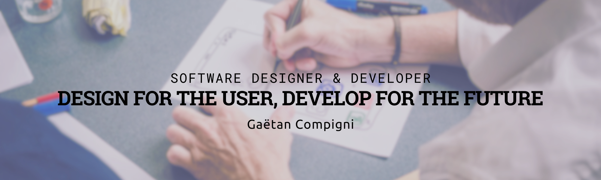
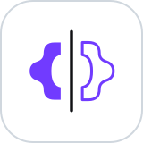
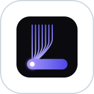
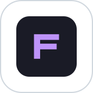

  

  

I spent 18 years in retail and events before switching to code, and I still build software the way I learned to serve people: around the person using it. Clear interfaces, accessibility first, and tools that feel obvious.

 

## ⭐ Flagship: HeryJs

<table>
<tr>
<td>

### [HeryJs](https://github.com/techmefr/HeryJs)

**The batteries-included framework for NestJS.** Describe your resources in a blueprint, generate a secured, multi-tenant backend, then own every line of it. No runtime schema to keep in sync.

`Auth` `RBAC` `Postgres RLS` `Jobs` `Real time` `Vector search` `OpenAPI` `MCP`

[**Read the docs →**](https://techmefr.github.io/HeryJs/)

</td>
</tr>
</table>

**The frontend toolkit around it.** Four small, typed libraries that compose around the same data flow:

<table>
<tr>
<td align="center" width="25%">
 
<b><a href="https://github.com/techmefr/nexdk">neXdk</a></b> 
One SDK for REST, GraphQL and WebSocket, any backend 
<a href="https://techmefr.github.io/nexdk/">Docs</a>
</td>
<td align="center" width="25%">
 
<b><a href="https://github.com/techmefr/dialectr">dialectr</a></b> 
One query, any dialect: Lomkit, PocketBase, Strapi 
<a href="https://techmefr.github.io/dialectr/">Docs</a>
</td>
<td align="center" width="25%">
 
<b><a href="https://github.com/techmefr/beepr">beepr</a></b> 
Typed events and notifications, composable adapters 
<a href="https://techmefr.github.io/beepr/">Docs</a>
</td>
<td align="center" width="25%">
 
<b><a href="https://github.com/techmefr/shamock">shamock</a></b> 
Schema-driven mocks and offline fallback 
<a href="https://techmefr.github.io/shamock/">Docs</a>
</td>
</tr>
</table>

 

## 📱 Apps you can try

<table>
<tr>
<td width="50%" valign="top">

<b><a href="https://github.com/techmefr/lumia">Lumia</a></b> 
Self-hosted RSS reader
 
Strips articles down to the article, summarises them and learns your tastes. Playlists, text to speech, saved reading position.  
<a href="https://techmefr.github.io/lumia/"><b>Live demo →</b></a>
</td>
<td width="50%" valign="top">

<b><a href="https://github.com/techmefr/familist">FamiList</a></b> 
Household shopping list
 
Reorders itself along the real aisle layout of each shop, so you walk the store once. Web and native mobile.  
<a href="https://techmefr.github.io/familist/"><b>Live demo →</b></a>
</td>
</tr>
<tr>
<td width="50%" valign="top">

<b><a href="https://github.com/techmefr/amiludo">amiLudo</a></b> 
Board game night companion
 
Scores, dice, timers, teams, a game shelf and game nights with sign-ups. Offline first, no ads. Android, iOS and web.  
<a href="https://techmefr.github.io/amiludo/app/"><b>Live demo →</b></a>
</td>
<td width="50%" valign="top">

<b><a href="https://github.com/techmefr/maki-story">Maki Story</a></b> 
Family audio books
 
Paper books read aloud by the people you love, each voice with its own color.  
<a href="https://tantara.vercel.app"><b>Live app →</b></a>
</td>
</tr>
</table>

 

## 🛠️ Developer tools

<table>
<tr>
<td width="50%" valign="top">

<b><a href="https://github.com/techmefr/kodilo">kodilo</a></b> 
238 tools in your browser
 
JSON, encoding, email, colors and more. No sign-up, no account, no tracking.  
<a href="https://techmefr.github.io/kodilo/"><b>Open kodilo →</b></a>
</td>
<td width="50%" valign="top">

<b><a href="https://github.com/techmefr/forge-ops">forge-ops</a></b> 
Proof-driven board for coding agents
 
A story only moves forward with evidence on disk, a twin test story and a final human gate.  
<a href="https://techmefr.github.io/forge-ops/"><b>Docs →</b></a>
</td>
</tr>
</table>

 

## 🧩 UI and build libraries

| | |
|---|---|
| [**charpente**](https://github.com/techmefr/charpente) | Pure CSS skeleton loaders: no runtime JS, 35 themes, seasonal themes by date. [Demo](https://techmefr.github.io/charpente/) |
| [**v0-adaptive-table**](https://github.com/techmefr/v0-adaptive-table) | Responsive table and card renderer for `@vuetify/v0`. [Docs](https://techmefr.github.io/v0-adaptive-table/) |
| [**env-attr-cleaner**](https://github.com/techmefr/env-attr-cleaner) | Strips `data-test-*` attributes from production builds: Vite, Rollup, Webpack, esbuild, Bun. [npm](https://www.npmjs.com/package/env-attr-cleaner) |

## 🤖 AI agents and testing

| | |
|---|---|
| [**mentis**](https://github.com/techmefr/mentis) | Harness-neutral skills, blocks and agents for AI coding agents, with a fresh-context review gate. |
| [**test-casebook**](https://github.com/techmefr/test-casebook) | An exhaustive testing doctrine for frontend stacks, with playbooks for [Node/TypeScript](https://github.com/techmefr/test-casebook-back-js) and [PHP](https://github.com/techmefr/test-casebook-back-php) backends. |

 

## 💻 Stack

 

<picture>
  <source media="(prefers-color-scheme: dark)" srcset="https://raw.githubusercontent.com/techmefr/techmefr/output/github-contribution-grid-snake-dark.svg" />
  <source media="(prefers-color-scheme: light)" srcset="https://raw.githubusercontent.com/techmefr/techmefr/output/github-contribution-grid-snake.svg" />
  
</picture>
